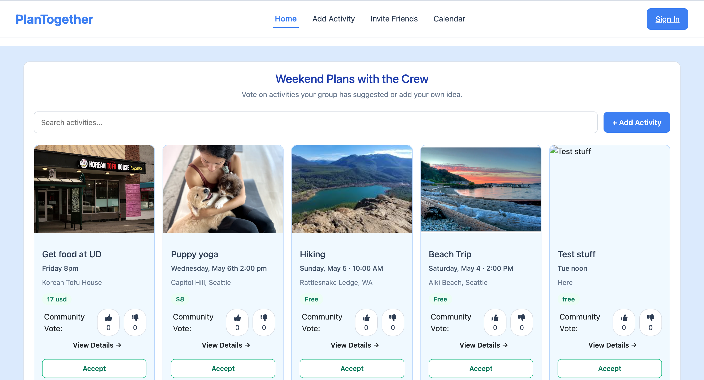

# PlanTogether

A collaborative web app that helps friend groups plan activities together: suggest ideas, compare options, vote, and see plans on a shared calendar, all in one place instead of a messy group chat.

Built as a team project for INFO 340 (Client-Side Development) at the University of Washington.



**Live site:** https://plantogether-1ccf5.web.app

## Features

- **Shared planning board**: add activity ideas with details like time, location, price, and notes
- **Voting**: upvote or downvote activities so the group's favorite options rise to the top
- **Search**: filter activities by name
- **Comments**: discuss each activity on its details page
- **Calendar views**: see planned activities in day and week views
- **Invite page**: share a link and see who's in the group
- **Sign-in**: user accounts with Firebase Authentication
- **Live sync**: activities, votes, and comments update in real time for everyone

## Tech Stack

- **React** (with Vite)
- **React Router** for page navigation
- **React-Bootstrap / Bootstrap** for layout and styling
- **Firebase Realtime Database** for live data
- **Firebase Authentication** for sign-in
- **Firebase Hosting** for deployment

## Running Locally

```bash
npm install
npm run dev
```

Then open the local URL shown in your terminal (usually http://localhost:5173).

## Team

- Mariana Moreno Ornelas
- Spencer Xu
- Ru Li
- Salsabila Abu
